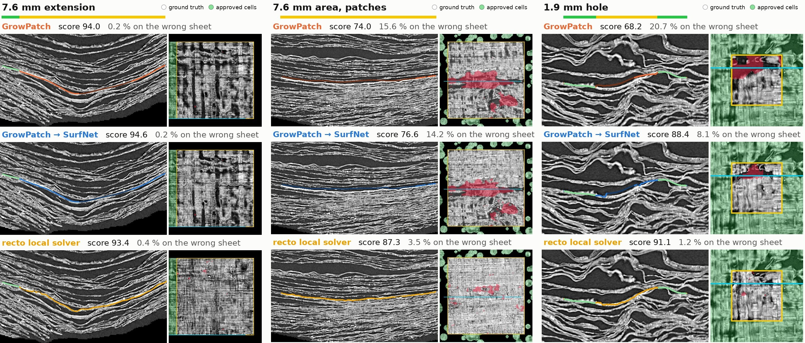
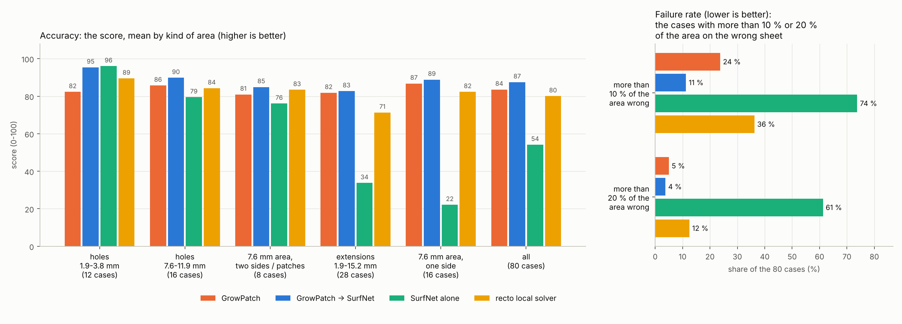
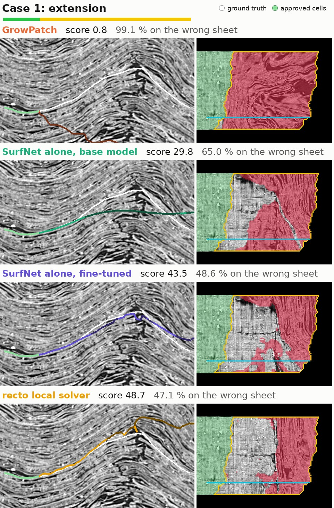
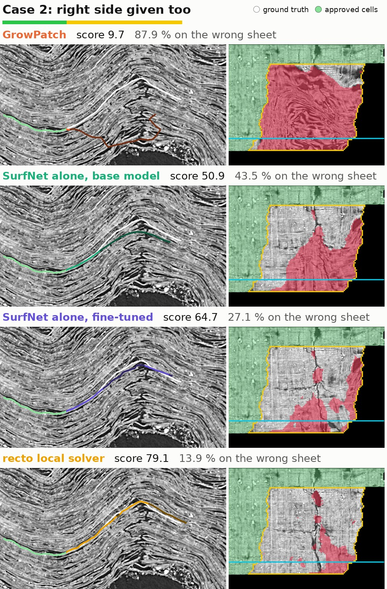

# SurfNet and the recto local solver

Two tools that place a papyrus sheet's surface in a CT scan of a Herculaneum scroll, starting from the part of the sheet
you have already approved:

- **SurfNet**, a trained network (22.8 M parameters). Run on GrowPatch's surface, it fixed 10 of the 19 benchmark
  cases that GrowPatch failed and failed none of the others. On its own, it fills small holes.
- **The recto local solver**, which needs no training. It grows the area outward from the approved cells along the
  layers visible in the CT, without the m7 surface prediction or VC3D. It is the fastest of the methods.

*Not tested, an option to try:* the recto local solver's surface as SurfNet's start in place of GrowPatch's, since
SurfNet corrects a start that is mostly right and the solver gives one without the m7, possibly faster on a strong GPU.

  

*Figure 1. Three of the 80 benchmark cases, each solved by GrowPatch, GrowPatch → SurfNet and the recto local
solver. In each: a CT cross-section with the method's surface (darker where it is on the wrong sheet), the approved
cells (green) and the ground truth (white); beside it, the method's surface over the area, red where it is on the wrong
sheet.*

80 test cases on four windings of PHerc0139 that SurfNet (the base model) never trained on, each hiding part of a
ground-truth winding next to approved cells. The score, the cases failed in brackets, and the best score in bold:

| area (cases) | GrowPatch (reference) | GrowPatch → SurfNet | SurfNet alone | recto local solver |
|---|---|---|---|---|
| hole 1.9-3.8 mm (12) | 82.3 (17 %) | 95.4 (0 %) | **96.0** (0 %) | 89.4 (0 %) |
| hole 7.6-11.9 mm (16) | 85.7 (25 %) | **89.8** (0 %) | 79.4 (69 %) | 84.2 (25 %) |
| 7.6 mm area, two sides / patches (8) | 80.9 (38 %) | **84.9** (25 %) | 76.1 (75 %) | 83.4 (25 %) |
| extension 1.9-15.2 mm (28) | 81.8 (25 %) | **82.7** (21 %) | 33.7 (93 %) | 71.3 (57 %) |
| 7.6 mm area, one side (16) | 86.8 (19 %) | **88.8** (6 %) | 22.1 (100 %) | 82.3 (44 %) |
| **all (80)** | 83.6 (24 %) | **87.5** (11 %) | 54.1 (74 %) | 80.0 (36 %) |
| time per case | 102 s | 127 s | 83 s | **39 s** |

Score (0-100): full credit within 2 voxels of the ground truth, none from half the winding spacing. Failed: more
than 10 % of the area on the wrong sheet. Every method gets only what a user would have: the approved cells, the area,
the CT and, for GrowPatch, the m7. Times per case on one T4 GPU, GrowPatch on one CPU core.

Case by case, GrowPatch → SurfNet scored higher than GrowPatch in 62 of the 80 cases and lower in 8, a mean gain of 3.9
points (95 % interval 2.1 to 6.1, resampling the 12 CT locations).

  

*Figure 2. The score by kind of area (left) and the failure rate over the 80 cases (right). Every case's scores,
the failures and the score by distance from the approved cells are in [the supplement](docs/SUPPLEMENTARY.md).*

### Fine-tuned on PHerc0211

The base model was fine-tuned on 415 mm² of approved cells of one PHerc0211 sheet (6,000 steps, about 40 minutes on one
24 GB GPU; more approved area may adapt it further, which was not tested). Both models were tested on five areas of the
same sheet that the fine-tuned model never trained on, approved later: (1) an extension up to 3.8 mm beyond the trained
cells, from a 1.9 mm strip of them; (2) the same area, also given the approved cells on its right side; (3) an area
beside the trained edge; (4, 5) holes 2.3 and 1.8 mm across inside a 0.95 mm ring of approved cells. Every method ran
and was scored as in the benchmark above (best per case in bold):

| method | 1 extension | 2 extension, right side given | 3 beside the edge | 4 hole 2.3 mm | 5 hole 1.8 mm |
|---|---|---|---|---|---|
| GrowPatch alone (reference) | 0.8 | 9.7 | 67.8 | 10.3 | 13.6 |
| GrowPatch → SurfNet, base model | 5.3 | 30.8 | 73.4 | 36.6 | 39.8 |
| GrowPatch → SurfNet, fine-tuned | 3.9 | 32.4 | **73.8** | 31.9 | 41.6 |
| SurfNet alone, base model | 29.8 | 50.9 | 64.6 | **97.8** | 97.8 |
| SurfNet alone, fine-tuned | 43.5 | 64.7 | 66.6 | 96.5 | 97.8 |
| recto local solver | **48.7** | **79.1** | 70.0 | **97.8** | **99.6** |

- **SurfNet alone:** fine-tuning raised its score by about 14 points on both extensions and by 2 beside the edge; on
  the holes both models score 96.5-97.8.
- **GrowPatch**, which follows the m7, put 85-99 % of the area on the wrong sheet in cases 1, 2, 4 and 5. Starting
  from its surface, SurfNet raised those scores by 3 to 28 points with either model, but more than half of each area
  stayed on the wrong sheet.
- **The recto local solver** scored highest on four of the five areas (level with SurfNet alone, base model, on case
  4), GrowPatch → SurfNet with the fine-tuned model on case 3. Beyond the trained edge (cases 1-3), every method had
  more than 10 % of the area on the wrong sheet.

  
  

*Figure 3. Cases 1 (left) and 2 (right), drawn as in Figure 1. Case 1's cross-section runs where the fine-tuned
model is on the right sheet and the base model is not; case 2's where GrowPatch is on the wrong sheet and the recto
local solver on the right one.*

The fine-tuned weights are on Hugging Face beside the base model's; the sheet, the cells the model trained on and the
five cases (inputs and ground truth) are in [`benchmark/finetune_pherc0211/`](benchmark/finetune_pherc0211); every
method's scores and how to run the test again are in [the supplement](docs/SUPPLEMENTARY.md#5-fine-tuning-on-pherc0211).

## Which to use

Right most of the time first, then speed, on the benchmark above:

- **Most reliable: GrowPatch → SurfNet.** The fewest failures in every kind of area, 11 % of cases against GrowPatch's
  24 %: it fixed 10 of GrowPatch's 19 failures and failed none of the other 61, for about 26 s more per case.
- **Fastest: the recto local solver, where approved cells surround the area** (a hole, two sides, patches): 85.8
  against GrowPatch's 83.5 and 17 % of cases failed against 25 %, in a third of GrowPatch's time, without the m7 or
  VC3D. GrowPatch → SurfNet is more accurate there (90.6, 6 % failed); beyond an approved edge the solver is less
  reliable.
- **Small holes without the m7 or VC3D: SurfNet alone** (96.0 on holes up to 3.8 mm, none failed).
- **Potentially: the recto local solver → SurfNet**, the untested option above.
- **With a large approved area: fine-tune SurfNet on it first** (above).

## Use

`bash setup.sh` (Linux, NVIDIA GPU) installs both tools; `bash benchmark/vc3d_setup.sh vc3d` adds VC3D for GrowPatch.
SurfNet's weights are on Hugging Face, [nestorvfx/surfnet](https://huggingface.co/nestorvfx/surfnet/tree/main), 91 MB
each: `surfnet_base.pt`, the base model, and `surfnet_pherc0211.pt`, fine-tuned on PHerc0211. Every method takes the
same inputs on the grid of one sheet: the sheet (VC3D tifxyz), the approved cells and the area to place (masks).
[The guide](docs/GUIDE.md) has the commands, a quick start on the two benchmark cases in `examples/` with their expected
scores, every option, and how to fine-tune SurfNet on your own sheet or train it again.

## How they work

**SurfNet.** Two 3-D residual U-Nets read the CT around the area in a 160 × 160-cell window (cells of 47.46 µm): a
context stream of ±96 voxels, about 7 windings to either side, decides which sheet; a fine stream of ±12 voxels places
it. The approved cells are given as prompts at their depth. For each cell the network predicts a distribution of the
surface's offset along the normal, and belief propagation turns these into one smooth surface through the approved
cells. The base model was trained for 42,000 steps on synthetic errors of 3,284 cm² of official ground truth (27
PHerc0139 windings, the PHerc1667 unwrap and 10 ink-labelled segments).

**The recto local solver.** A matched filter learns the CT's depth profile at the approved cells' surface. The area is
then grown outward from the approved cells in patches, each solved along the normals over several windings, guided by
that filter and by the slope of the CT's layers between neighbouring cells; every patch re-solves the cells grown so
far. An optional fibre step moves the surface through the thick horizontal fibres that continue from the approved
cells.

## Limits

- **One scroll, close to SurfNet's training data.** The 80 cases lie at 12 locations on four windings of PHerc0139,
  1-4 windings from the nearest one SurfNet trained on; the intervals resample locations, not cases. The gain over
  GrowPatch was similar on the two windings that chose SurfNet's checkpoint and the two that never did (+4.6 and +3.4).
- **Settings chosen on these windings.** How SurfNet is applied was chosen on runs that included 26 of the 80 cases; on
  the other 54, GrowPatch → SurfNet scores 88.8 against GrowPatch's 85.0 (9 % failed against 19 %). The recto local
  solver's settings come from PHerc0211 and were checked on 21; on the other 59 it scores 80.3.
- **The metric.** Credit ends at half the winding spacing, so where sheets lie closer, a cell on the neighbouring
  winding can still earn some. The ground truth was traced at 2.4 µm and registered onto this 9.362 µm scan, hence
  full credit within 2 voxels.

## Repository and license

`surfnet/` and `recto_local_solver/` (the tools), `benchmark/` (the benchmark's scripts, and `finetune_pherc0211/`, the
fine-tune test's data), `examples/`, `configs/`, `docs/` ([guide](docs/GUIDE.md), [supplement](docs/SUPPLEMENTARY.md),
figures, results) and `tests/`.

The code and SurfNet's weights (both models) are released under the [MIT License](LICENSE). The CT scans and the
ground truth they were trained and tested on, including the examples' ground truth, are Vesuvius Challenge open data,
"Vesuvius Challenge - CT Scans of Herculaneum Papyri", licensed CC BY-NC 4.0. The PHerc0211 sheet, its cases and the
mask of the cells the fine-tuned model trained on derive from that data and are released under
[CC BY-NC 4.0](benchmark/finetune_pherc0211/LICENSE.md).
