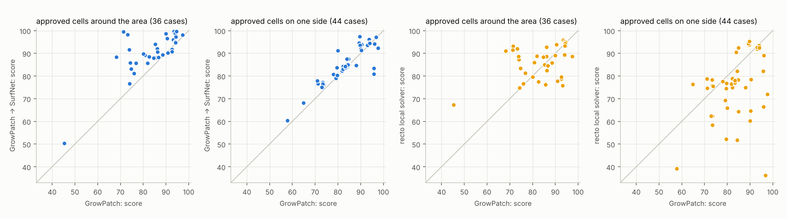
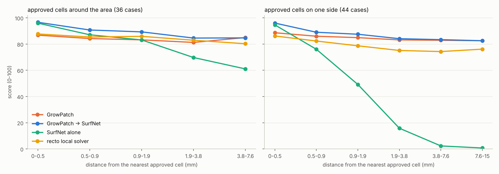
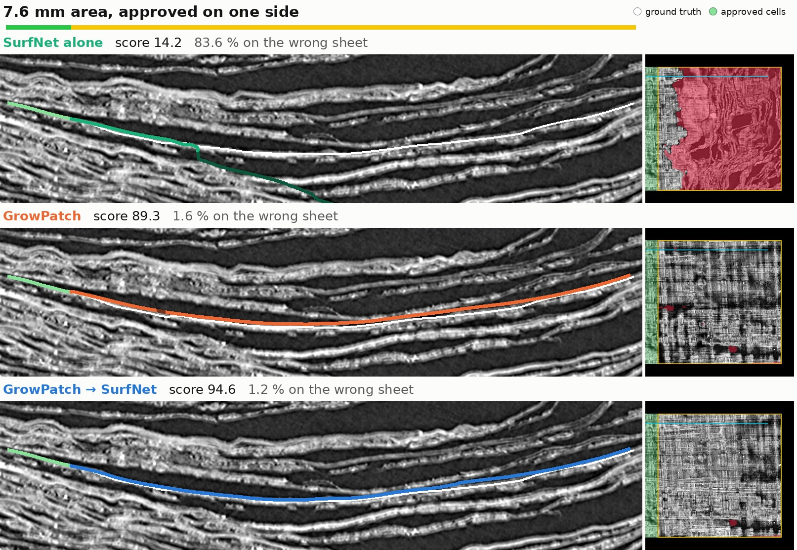
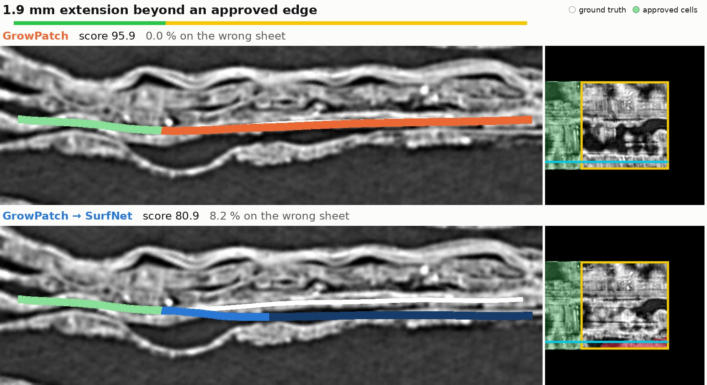
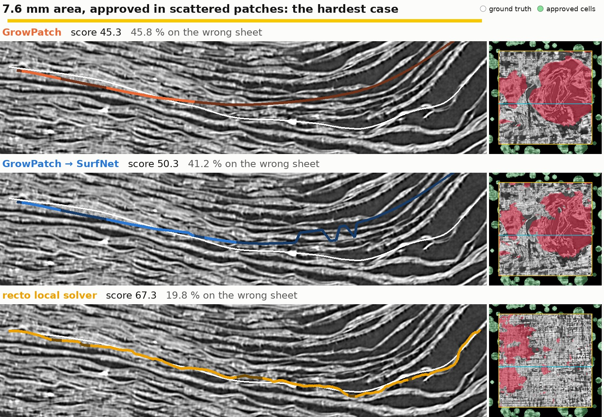
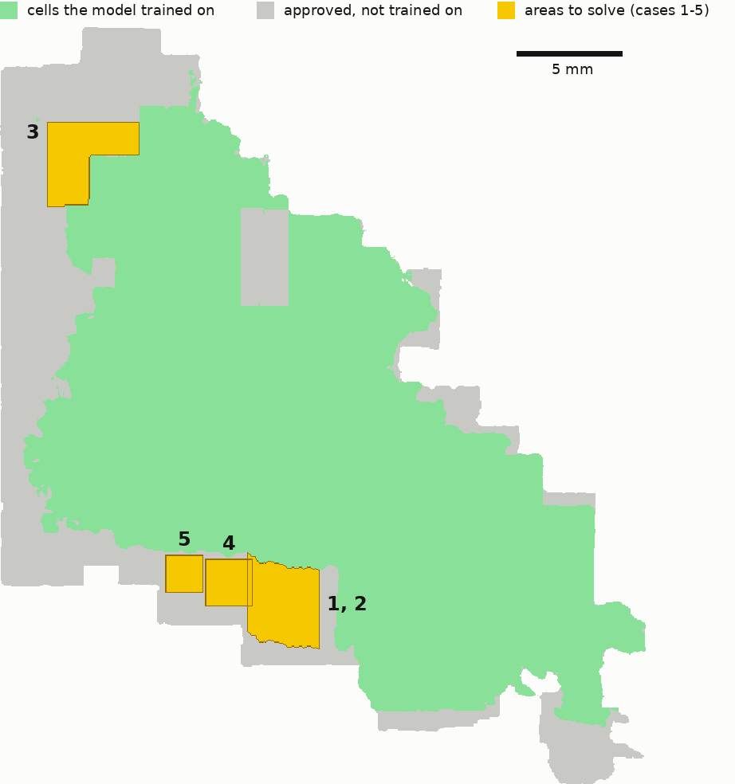

# SurfNet and the recto local solver: supplement

The benchmark behind the [README](../README.md)'s results, in full, and the fine-tuned model's test on PHerc0211.

1. [The benchmark](#1-the-benchmark)
2. [Results](#2-results)
3. [More figures](#3-more-figures)
4. [Reproducing it](#4-reproducing-it)
5. [Fine-tuning on PHerc0211](#5-fine-tuning-on-pherc0211)

## 1. The benchmark

**Ground truth.** PHerc0139 w056-w059, windings traced by the Vesuvius Challenge team. They are registered onto the
9.362 µm volume ("t2", 2026-11-16), whose m7 surface prediction and normal grids are published. SurfNet trained on
w023-w040 and w047-w055. w056-w057 were its validation windings and w058-w059 its test windings.

Not used:
- community prize submissions;
- tracer outputs (`auto_grown` segments);
- w041-w046 (inconsistent: duplicates).

**Cases.** Each case is a square window of a ground-truth winding, with known cells and an area to place. Every kind
of case is cut at the same 12 locations, 3 on each winding (cells of 47.46 µm).

| set | known cells | areas |
|---|---|---|
| main (`cases.yaml`) | a 0.95 mm ring; a 1.9 mm strip; 0.24-3.8 mm on one side; 0.95 mm on two sides; scattered patches | holes 1.9-11.9 mm, extensions 1.9-15.2 mm, 7.6 mm areas |
| full context (`cases_ctx64.yaml`) | 3 mm (the 64 cells `surfnet correct` reads around an area) | holes 3.8-11.9 mm, extensions 1.9-7.6 mm |

**The 80 cases** (`results/subset80.txt`, `benchmark/subset.py`) were drawn at random before any result of this run.
They come from the 240 cases of both sets with an area to grow, in proportion to the five kinds of area:

| kind of area | cases |
|---|---|
| holes 1.9-3.8 mm | 12 |
| holes 7.6-11.9 mm | 16 |
| extensions 1.9-15.2 mm | 28 |
| 7.6 mm areas known on one side | 16 |
| 7.6 mm areas known on two sides or in patches | 8 |

They were drawn in two steps:
- **50 cases** at random within each kind (seed 0);
- **30 more** (seed 1), spread evenly over each kind's amounts of known context: for one-sided areas 0.47, 0.95 and
  3.8 mm; the 0.24 mm strip only among the first 50. These three amounts were chosen from an earlier test as those at
  which SurfNet alone did best.

Earlier runs on the same four windings had chosen how SurfNet is applied after GrowPatch (fast mode, the re-solve,
keeping GrowPatch's surface where its runs disagree); 26 of the 80 cases were among those they used
(`results/surfnet_used_cases.txt`), and 21 chose or checked the recto local solver's settings
(`results/recto_used_cases.txt`). The results on the other cases are given below.

**Methods.** Every method gets what a user has: a sheet holding only the known cells' positions, the known cells and
the area as masks, the CT and, for GrowPatch, the m7 and its normal grids. The ground truth only scores.

| name | what | the tools |
|---|---|---|
| E | thin-plate extrapolation of the known cells (SurfNet alone's start) | - |
| S5 | SurfNet alone, default solve: 5 runs, 2 flips, up to 3 refinement passes | `surfnet correct --start bridge` |
| G | GrowPatch (VC3D `vc_grow_seg_from_seed --resume`, build e5707e4 of 2026-11-23) along the m7, single-threaded, on the sheet's grid | `surfnet grow --threads 1` |
| GF4Cmed | G, then SurfNet's fast mode: 4 runs, 1 flip, 1 pass | `surfnet correct --mode fast` on `grown/surface` |
| GF4Cmedx1T | GF4Cmed, then a re-solve with 8 runs of the cells whose runs differ by more than half a winding | `--mode fast --resolve` |
| **GF4CmedK** | GF4Cmed, with GrowPatch's surface kept on the cells whose runs differ by more than half a winding: **"GrowPatch → SurfNet"** | `--mode fast --keep-draft` |
| GF4Cmedx1TK | GF4Cmedx1T, with GrowPatch's surface kept where the re-solve's runs still differ | `--mode fast --resolve --keep-draft` |
| RF | the recto local solver's frame: calibration on the known cells, then the lamination-following growth | `recto-local-solver solve` (`frame.tifxyz`) |
| RFS | RF, then the fibre step | the same run (`frame_fibre_step.tifxyz`) |

`bench.py` applies each way one step per method, from the previous step's saved result, with the functions and settings
of `surfnet correct`. A test (`tests/test_benchmark.py`) checks that `surfnet correct` on the benchmark's user inputs
gives the surfaces the benchmark scored (on a synthetic scroll; on the 80 cases `surfnet correct` keeps the sheet's grid
as the benchmark did: their known cells lie within 3.7 % of the model's cell). `recto_case.py` runs the recto local
solver on a case with the function its command line calls (`solve_area`), from the case's known cells, area and CT, and
scores both results with `bench.py`'s own scorer; on a T4 its command line gave the same surfaces as `recto_case.py`, to
the bit (on `0139_w056__03_extend_side_k64_s40__L0`).

**The metric** (`surfnet/eval/score_gpu.py`, `surfnet/eval/score.py`). Each area cell of the truth is compared with the
exact closest point of the method's surface. The error is that point's offset along the true normal; the cell is covered
when the point lies within 3 voxels of the normal line.
- **Score (0-100):** each cell earns full credit within 2 voxels of the truth, falling linearly to none at half the
  winding spacing, and none beyond it or when uncovered; the case's score is the mean over its area. The spacing is the
  median distance to the next ground-truth winding along the normals: w056 13.4, w057 12.0, w058 12.4, w059 12.7
  voxels, so credit ends at 6.0-6.7 voxels. Full credit within 2 voxels: the truth's own registration error is about
  1 voxel, and a sheet is several voxels thick.
- **Wrong sheet:** a cell half a winding or more from the truth (closer to a neighbouring winding), or uncovered.
- **Failed case:** more than 10 % of the area on the wrong sheet (20 % also reported).
- **Also:** the median error (p50), coverage, the score by distance from the known cells.

**Where it ran.** One run per case; the times include the case's CT download.

| what | where |
|---|---|
| GrowPatch | Kaggle CPU sessions, one case per core, single-threaded (with several threads its surface differs from run to run) |
| SurfNet's ways from GrowPatch's surface | Kaggle, one worker per T4 GPU, fp16 |
| SurfNet alone (S5) | Google Colab, one T4, fp16, the same code |
| the recto local solver (RF, RFS) | Google Colab, one T4, one process per case (`recto_case.py`) |

A way's time adds its steps' times: GrowPatch on one CPU core, then SurfNet on one GPU. The recto local solver's is its
own run on one GPU: RF the calibration and the frame, RFS the whole run.

## 2. Results

### By kind of area

The score, mean over the cases (`results/ways_families.json`; per case: `results/ways.json`, `results/scores.jsonl`).

| kind of area (cases) | E | S5 | G | GF4Cmed | GF4Cmedx1T | **GF4CmedK** | GF4Cmedx1TK | RF | RFS |
|---|---|---|---|---|---|---|---|---|---|
| holes 1.9-3.8 mm (12) | 70.4 | 96.0 | 82.3 | 95.7 | 95.9 | 95.4 | 95.9 | 89.4 | 85.9 |
| holes 7.6-11.9 mm (16) | 32.3 | 79.4 | 85.7 | 87.2 | 89.9 | 89.8 | 89.8 | 84.2 | 81.8 |
| 7.6 mm area, two sides / patches (8) | 31.1 | 76.1 | 80.9 | 85.3 | 86.0 | 84.9 | 86.0 | 83.4 | 82.8 |
| extensions 1.9-15.2 mm (28) | 24.4 | 33.7 | 81.8 | 72.0 | 76.3 | 82.7 | 81.9 | 71.3 | 71.0 |
| 7.6 mm area, one side (16) | 12.6 | 22.1 | 86.8 | 78.8 | 88.0 | 88.8 | 89.3 | 82.3 | 79.9 |
| **all (80)** | 31.2 | 54.1 | 83.6 | 81.3 | 85.2 | **87.5** | 87.5 | 80.0 | 78.3 |
| failures: more than 10 % on the wrong sheet | 75 | 59 | 19 | 30 | 19 | **9** | 13 | 29 | 28 |
| failures: more than 20 % on the wrong sheet | 72 | 49 | 4 | 13 | 5 | **3** | 2 | 10 | 10 |
| median error, p50 (vox; the median over the cases) | 4.08 | 1.54 | 1.21 | 1.33 | 1.27 | **1.13** | 1.23 | 1.64 | 1.70 |
| coverage | 0.556 | 0.671 | 0.984 | 0.978 | 0.974 | 0.982 | 0.980 | 0.957 | 0.968 |
| seconds per case | - | 83 | 102 | 127 | 160 | **127** | 160 | 39 | 48 |

The bold column is the best way. With known cells around the area (the 36 holes, two-sided and patch cases), RF scores
85.8 in 31 s per case, GF4CmedK 90.6 in 126 s and G 83.5 in 96 s; failed: 6, 2 and 9 cases. The recto local solver's
fibre step leaves it 1.7 points lower overall.

- **The fast step alone (GF4Cmed) does worse than GrowPatch beyond a known edge** (extensions 72.0 against 81.8).
- **Keeping GrowPatch's surface where SurfNet's runs disagree (K) removes that loss** and keeps the gain where known
  cells surround the area. Share of the area's cells kept from GrowPatch:

  | kind of area | kept from GrowPatch |
  |---|---|
  | extensions | 56 % |
  | areas known on one side | 55 % |
  | two sides / patches | 30 % |
  | holes 7.6-11.9 mm | 15 % |
  | holes up to 3.8 mm | 3 % |
- **The re-solve (x1T) recovers part of the loss on its own**, but adds 33 s per case. With K as well (x1TK) it gives
  the same mean as GF4CmedK (87.5), with more failures (13 against 9) and more cases worse than GrowPatch (below).

Seconds per case by kind of area:

| kind of area | S5 | G | GF4CmedK | GF4Cmedx1TK | RF | RFS |
|---|---|---|---|---|---|---|
| holes 1.9-3.8 mm | 52 | 32 | 46 | 53 | 8 | 11 |
| holes 7.6-11.9 mm | 161 | 139 | 189 | 242 | 52 | 68 |
| 7.6 mm area, two sides / patches | 76 | 105 | 122 | 151 | 23 | 31 |
| extensions 1.9-15.2 mm | 70 | 119 | 147 | 185 | 56 | 66 |
| 7.6 mm area, one side | 55 | 85 | 97 | 120 | 26 | 33 |

SurfNet's own step in GF4CmedK: 26 s per case on average (median 16 s, at most 155 s). GrowPatch: 102 s (median 83 s,
at most 404 s).

### Against GrowPatch, case by case

<p align="center">
  
</p>

*Figure S5. Every case's score against GrowPatch alone: GrowPatch → SurfNet (the two panels on the left) and the recto
local solver (the two on the right). Above the diagonal, the method did better than GrowPatch.*

Better / worse: by more than 0.5 points. The interval is a 95 % bootstrap interval of the mean difference, resampling
the 12 locations (`ways.py locations`).

| kind of area (cases) | GF4CmedK: better / worse | mean | interval | largest drop | GF4Cmedx1TK: better / worse | mean | largest drop |
|---|---|---|---|---|---|---|---|
| holes 1.9-3.8 mm (12) | 12 / 0 | +13.1 | +5.8 to +19.9 | - | 11 / 0 | +13.6 | - |
| holes 7.6-11.9 mm (16) | 14 / 2 | +4.1 | +1.9 to +6.1 | -1.9 | 12 / 3 | +4.1 | -5.5 |
| 7.6 mm area, two sides / patches (8) | 6 / 1 | +4.0 | +1.7 to +7.9 | -0.7 | 7 / 1 | +5.1 | -2.3 |
| extensions 1.9-15.2 mm (28) | 19 / 5 | +0.9 | -1.4 to +3.1 | -15.0 | 17 / 7 | +0.1 | -19.2 |
| 7.6 mm area, one side (16) | 11 / 0 | +2.1 | +0.8 to +3.9 | - | 10 / 3 | +2.6 | -1.9 |
| **all (80)** | **62 / 8** | **+3.9** | **+2.1 to +6.1** | -15.0 | 57 / 14 | +3.9 | -19.2 |

- **The 8 cases where GF4CmedK is worse:** 5 extensions 1.9-3.8 mm deep, where GrowPatch scored 88-98 and had at most
  0.8 % of the area on the wrong sheet; the correction put 0-8 % there (largest drop: 95.9 to 80.9, Figure S2). The
  other 3 drop by at most 1.9 points.
- **The two kinds of winding:** on SurfNet's validation windings (w056-w057) GF4CmedK gained +4.6 points and on its
  test windings (w058-w059) +3.4.

**On the 54 cases not used to choose how SurfNet is applied** (`results/surfnet_used_cases.txt` left out): GF4CmedK
88.8, G 85.0 (+3.7 points; better in 38, worse in 8, the same 8 as above); failed: 5 against 10 (more than 20 % on the
wrong sheet: 1 against 2); no case G passed fails.

The recto local solver against GrowPatch, the same way:

| kind of area (cases) | RFS: better / worse | mean | interval | largest drop | RF: better / worse | mean | interval | largest drop |
|---|---|---|---|---|---|---|---|---|
| holes 1.9-3.8 mm (12) | 6 / 6 | +3.6 | -3.6 to +10.3 | -14.0 | 8 / 2 | +7.2 | -2.4 to +15.4 | -17.4 |
| holes 7.6-11.9 mm (16) | 3 / 13 | -4.0 | -8.6 to -1.1 | -18.5 | 7 / 7 | -1.5 | -5.5 to +1.9 | -13.9 |
| 7.6 mm area, two sides / patches (8) | 3 / 4 | +1.8 | -3.5 to +6.0 | -15.8 | 3 / 4 | +2.5 | -1.8 to +6.3 | -13.1 |
| extensions 1.9-15.2 mm (28) | 4 / 24 | -10.8 | -17.7 to -5.7 | -54.6 | 7 / 20 | -10.5 | -18.1 to -3.7 | -60.5 |
| 7.6 mm area, one side (16) | 4 / 12 | -6.9 | -14.8 to -2.2 | -29.5 | 4 / 10 | -4.5 | -11.1 to +0.4 | -25.7 |
| **all (80)** | **20 / 59** | **-5.2** | **-8.7 to -1.9** | -54.6 | **29 / 43** | **-3.5** | **-7.7 to +0.8** | -60.5 |

- **The two kinds of winding:** RF -2.7 points on w056-w057 and -4.2 on w058-w059 (RFS -3.7 and -6.3).
- **Its largest drops** are extensions that GrowPatch placed well: the 5 largest are all extensions, where GrowPatch
  scored 80-97 (largest: `0139_w059__03_extend_side_k64_s40__L1`, RF 36.3, GrowPatch 96.8).

**On the 59 cases not used to choose or check it** (`results/recto_used_cases.txt` left out): RF 80.3, RFS 78.2
(GrowPatch 84.2, GF4CmedK 88.0 on the same cases); failed: RF 23, RFS 21 (GrowPatch 15, GF4CmedK 8).

**Against GF4CmedK, case by case:** RF better in 12 of the 80 cases and worse in 65 (mean -7.4 points); with known
cells around the area (the 36 holes, two-sided and patch cases) better in 5 and worse in 29 (mean -4.8).

### Failures

`ways.py robust`.
- **Fixed:** GrowPatch's failed cases that the way brings to the threshold or below.
- **New:** cases GrowPatch passed that the way fails.

| more than … on the wrong sheet | way | failed of 80 | GrowPatch's failures: still failed / fixed | new failures | worst score | 10th percentile |
|---|---|---|---|---|---|---|
| 10 % | G | 19 | - | - | 45.3 | 72.7 |
|  | S5 | 59 | 16 / 3 | 43 | 5.9 | 13.6 |
|  | **GF4CmedK** | 9 | 9 / 10 | 0 | 50.3 | 76.6 |
|  | GF4Cmedx1TK | 13 | 8 / 11 | 5 | 55.9 | 75.9 |
|  | RF | 29 | 13 / 6 | 16 | 36.3 | 64.1 |
|  | RFS | 28 | 11 / 8 | 17 | 40.7 | 61.5 |
| 20 % | G | 4 | - | - | | |
|  | S5 | 49 | 2 / 2 | 47 | | |
|  | **GF4CmedK** | 3 | 3 / 1 | 0 | | |
|  | GF4Cmedx1TK | 2 | 2 / 2 | 0 | | |
|  | RF | 10 | 1 / 3 | 9 | | |
|  | RFS | 10 | 1 / 3 | 9 | | |

The hardest case for GrowPatch and GrowPatch → SurfNet:
- **The case:** `0139_w058__13_context_patches_k20_s160__L2`, a 7.6 mm area known in scattered patches (Figure S3).
- **Scores:** GrowPatch 45.3, GF4CmedK 50.3, SurfNet alone 70.8, RF 67.3, RFS 71.7.

The next two for GrowPatch:
- `0139_w058__07_extend_side_k40_s320__L1`, a 15.2 mm extension: GrowPatch 57.8, GF4CmedK 60.4, RF 39.2, RFS 40.7;
- `0139_w059__04_extend_side_k64_s80__L2`, a 3.8 mm extension: GrowPatch 64.9, GF4CmedK 68.2, RF 76.3, RFS 75.9.

### By distance from the nearest known cell

The score of the cells at that distance, mean over the cases that have such cells (Figure S6).

<p align="center">
  
</p>

*Figure S6. The score by distance from the nearest approved cell. SurfNet alone stays reliable only close to approved
cells; beyond an approved edge, the recto local solver falls behind GrowPatch.*

| known cells | way | 0-0.5 mm | 0.5-0.9 | 0.9-1.9 | 1.9-3.8 | 3.8-7.6 | 7.6-15 |
|---|---|---|---|---|---|---|---|
| around the area (36 cases) | S5 | 96.0 | 87.1 | 83.2 | 69.7 | 61.0 |  |
|  | G | 86.8 | 84.2 | 83.2 | 81.3 | 85.0 |  |
|  | GF4CmedK | 96.6 | 90.7 | 89.3 | 84.6 | 84.7 |  |
|  | RF | 87.7 | 85.4 | 85.9 | 82.9 | 80.3 |  |
|  | RFS | 86.3 | 82.2 | 83.1 | 81.2 | 77.7 |  |
| on one side (44 cases) | S5 | 94.6 | 76.0 | 49.2 | 15.8 | 2.3 | 0.7 |
|  | G | 88.6 | 86.0 | 84.9 | 83.2 | 82.9 | 82.6 |
|  | GF4CmedK | 96.0 | 89.0 | 87.5 | 84.1 | 83.4 | 82.6 |
|  | RF | 86.2 | 82.3 | 78.7 | 75.1 | 74.3 | 76.1 |
|  | RFS | 84.7 | 79.8 | 77.0 | 73.0 | 72.5 | 73.8 |

### By kind of case

The score, mean over the cases of each kind in the 80 (known and area in cells of 47.46 µm: 5 = 0.24 mm,
10 = 0.47, 20 = 0.95, 40 = 1.9, 64 = 3.0, 80 = 3.8, 160 = 7.6, 250 = 11.9, 320 = 15.2).

| case | known | area | cases | E | S5 | G | GF4CmedK | GF4Cmedx1TK | RF | RFS |
|---|---|---|---|---|---|---|---|---|---|---|
| hole | 20 | 40 | 3 | 82.1 | 95.7 | 79.6 | 94.9 | 96.2 | 90.5 | 88.0 |
| hole | 20 | 80 | 3 | 66.9 | 97.1 | 82.4 | 96.7 | 97.1 | 90.1 | 87.2 |
| hole | 64 | 80 | 6 | 66.2 | 95.6 | 83.6 | 94.9 | 95.2 | 88.6 | 84.1 |
| hole | 20 | 160 | 6 | 34.9 | 86.6 | 85.0 | 90.9 | 91.5 | 86.1 | 84.1 |
| hole | 64 | 160 | 3 | 35.6 | 82.5 | 84.2 | 89.2 | 89.8 | 83.6 | 82.0 |
| hole | 20 | 250 | 3 | 34.1 | 84.0 | 89.1 | 90.7 | 89.1 | 86.1 | 82.0 |
| hole | 64 | 250 | 4 | 24.4 | 63.1 | 85.4 | 87.9 | 87.7 | 80.6 | 77.8 |
| extension | 40 | 40 | 6 | 47.2 | 62.3 | 85.4 | 85.1 | 81.3 | 70.9 | 73.5 |
| extension | 64 | 40 | 3 | 40.1 | 48.1 | 88.0 | 85.7 | 81.6 | 59.1 | 67.9 |
| extension | 40 | 80 | 1 | 34.7 | 59.3 | 84.7 | 87.5 | 86.4 | 78.3 | 83.5 |
| extension | 64 | 80 | 3 | 25.5 | 29.3 | 79.7 | 81.0 | 83.4 | 81.0 | 79.8 |
| extension | 40 | 160 | 3 | 12.0 | 23.1 | 80.2 | 82.0 | 82.3 | 77.1 | 70.6 |
| extension | 64 | 160 | 7 | 14.3 | 23.2 | 81.4 | 83.1 | 82.6 | 71.3 | 68.7 |
| extension | 40 | 320 | 5 | 6.4 | 9.5 | 76.1 | 78.0 | 79.6 | 68.4 | 65.5 |
| known on one side | 5 | 160 | 3 | 10.5 | 18.4 | 88.2 | 91.2 | 91.2 | 87.4 | 86.6 |
| known on one side | 10 | 160 | 3 | 12.2 | 23.5 | 86.7 | 87.3 | 87.8 | 78.6 | 77.7 |
| known on one side | 20 | 160 | 7 | 14.6 | 24.0 | 85.2 | 87.7 | 88.1 | 79.0 | 75.2 |
| known on one side | 80 | 160 | 3 | 10.5 | 20.1 | 89.0 | 90.8 | 91.9 | 88.6 | 86.1 |
| known on two sides | 20 | 160 | 3 | 31.2 | 74.5 | 89.9 | 91.0 | 91.1 | 85.1 | 81.8 |
| scattered known patches | 20 | 160 | 5 | 31.1 | 77.0 | 75.6 | 81.2 | 82.9 | 82.3 | 83.3 |

- **Amount of known context:** in this set it made no consistent difference to GrowPatch → SurfNet, from a 0.24 mm
  strip to 3.8 mm on one side, and from a 0.95 mm ring to 3 mm around holes.
- **Few cases per row:** each row holds 1-7 cases from different locations.

### By location

The mean score, and the failed cases (more than 10 % on the wrong sheet).

| location | cases | G | GF4CmedK | GF4Cmedx1TK | S5 | RF | RFS | failures: G / GF4CmedK / S5 / RF / RFS |
|---|---|---|---|---|---|---|---|---|
| w056 L0 | 9 | 84.5 | 84.5 | 82.9 | 57.8 | 74.9 | 78.9 | 3 / 1 / 6 / 6 / 6 |
| w056 L1 | 4 | 80.9 | 84.0 | 85.0 | 54.8 | 62.9 | 64.3 | 1 / 0 / 2 / 3 / 3 |
| w056 L2 | 3 | 93.8 | 98.2 | 97.8 | 70.8 | 94.9 | 90.3 | 0 / 0 / 1 / 0 / 0 |
| w057 L0 | 6 | 79.6 | 90.6 | 92.8 | 56.6 | 89.5 | 83.1 | 0 / 0 / 3 / 1 / 1 |
| w057 L1 | 6 | 90.6 | 96.3 | 97.7 | 40.4 | 90.9 | 88.1 | 0 / 0 / 4 / 1 / 1 |
| w057 L2 | 5 | 80.6 | 85.4 | 86.6 | 59.5 | 81.5 | 80.3 | 1 / 1 / 5 / 1 / 1 |
| w058 L0 | 8 | 72.9 | 81.3 | 80.1 | 51.7 | 77.7 | 69.5 | 1 / 1 / 6 / 3 / 4 |
| w058 L1 | 10 | 81.1 | 84.5 | 85.8 | 46.2 | 77.3 | 76.9 | 6 / 2 / 9 / 5 / 4 |
| w058 L2 | 9 | 87.8 | 88.1 | 86.2 | 64.9 | 73.8 | 72.2 | 1 / 1 / 6 / 4 / 4 |
| w059 L0 | 5 | 86.1 | 88.4 | 85.0 | 71.8 | 83.8 | 84.9 | 0 / 0 / 4 / 0 / 0 |
| w059 L1 | 9 | 94.4 | 95.0 | 94.5 | 45.5 | 85.8 | 84.1 | 0 / 0 / 8 / 1 / 1 |
| w059 L2 | 6 | 72.0 | 78.9 | 81.9 | 45.2 | 75.0 | 74.2 | 6 / 3 / 5 / 4 / 3 |

### Caveats

- **One scroll, 12 locations:** see the README's Limits.
- **The reference.** The windings were traced on 2.4 µm scans and registered onto the 9.362 µm volume. Errors below
  about 1 voxel are at the limit of what it resolves, hence full credit within 2 voxels.
- **Credit ends at half the winding spacing,** one spacing per winding: where sheets lie closer together than that, a
  cell on the neighbouring winding can still earn some.
- **Times:** one run per case. They show the cost; they are not a timing benchmark.

## 3. More figures

The images are drawn as in the README's Figure 1: a CT cross-section with the method's surface (thick: its colour on
the right sheet, darker on the wrong one; green over the known cells) and the truth (white); beside it the CT on the
surface, turned so that the cross-section (cyan) runs left to right, with red cells on the wrong sheet. Each method's
score and share of the area on the wrong sheet are given beside its name.

<p align="center">
  
</p>

*Figure S1. Why SurfNet alone is not for areas beyond a known edge: a 7.6 mm area known on one side (a 0.95 mm strip,
`0139_w057__10_context_side_k20_s160__L1`). Its surface keeps to the sheet for about 1.5 mm from the strip, then
leaves it and this view (3 windings either side). GrowPatch follows the sheet, and the correction keeps to it.*

<p align="center">
  
</p>

*Figure S2. The case where GrowPatch → SurfNet did worst against GrowPatch: a 1.9 mm extension
(`0139_w056__04_extend_side_k40_s40__L0`). GrowPatch had no cell on the wrong sheet. The correction moved a strip along
the area's edge onto the wrong sheet (red, 8 % of the area); the cross-section runs along it.*

<p align="center">
  
</p>

*Figure S3. The hardest case for GrowPatch and GrowPatch → SurfNet: a 7.6 mm area known in scattered patches
(`0139_w058__13_context_patches_k20_s160__L2`). Both have 41-46 % of the area on the wrong sheet; the recto local
solver's frame 20 % (score 67.3). SurfNet alone scores 70.8 here (not drawn).*

## 4. Reproducing it

`benchmark/bench.py` runs every stage. Each writes its own results tree, which later stages read (`--results`).
`--only` takes case names; the 80 are in `docs/results/subset80.txt`, one per line, with their set (`main` or `ctx`).

```bash
cd benchmark
python bench.py cases --work W                                   # the main set (CPU)
python bench.py cases --work W64 --config cases_ctx64.yaml       # the full-context set
python subset.py main=W/cases ctx=W64/cases OUT                  # the 80: OUT/subset80.txt
L=$(awk '$1 == "main" {print $2}' OUT/subset80.txt)              # then the same for W64 and "ctx"
python bench.py growpatch --work W --out R/grow --apprun vc3d/squashfs-root/AppRun --threads 1 --only $L     # CPU
python bench.py surfnet   --work W --out R/s5 --ckpt M.pt --amp fp16 --methods S5 --split case --only $L     # GPU
python bench.py surfnet   --work W --out R/ways --ckpt M.pt --amp fp16 --split case --results R/grow \
  --methods GF4Cmed,GF4Cmedx1T,GF4CmedK,GF4Cmedx1TK --only $L
python bench.py score     --work W --results R/grow R/s5 R/ways --out R/scores --only $L
#   (--errors R/scores: rescored from the per-cell errors it saved, without recomputing the closest points)
for c in $L; do python recto_case.py --case W/cases/$c --out R/recto --cache ct_cache; done              # GPU
python -c "import glob, json; [print(json.dumps(json.load(open(f)))) for f in sorted(glob.glob('R/recto/*/scores.json'))]" \
  > R/recto/scores.jsonl                                           # the cases' score rows, one per line
```

Then, from the score files and results trees only:

```bash
python ways.py analyse   --scores R/scores/scores.jsonl ... R/recto/scores.jsonl --trees R/grow R/s5 R/ways ... R/recto \
  --out ways.json                                                  # (bench.py's score files first)
python ways.py report    ways.json --pairs GF4CmedK:G GF4Cmedx1TK:G RFS:G RF:G   # by kind of area (-> ways_families.json)
python ways.py robust    ways.json                                    # failures (more than 10 / 20 % wrong)
python ways.py report    ways.json --methods RF,RFS --exclude ../docs/results/recto_used_cases.txt   # the held-out 59
python ways.py report    ways.json --methods G,GF4CmedK --pairs GF4CmedK:G \
  --exclude ../docs/results/surfnet_used_cases.txt                    # surfnet's held-out 54 (and robust, the same)
python ways.py report    ways.json --methods RF,GF4CmedK --pairs RF:GF4CmedK                   # RF against GF4CmedK
python ways.py locations ways.json                                    # by location, with intervals
python ways.py locations ways.json --ways G,RFS,RF                    # the same for the recto local solver
python figures.py chart  --analysis ways.json --out fig2_results.png
python figures.py reach  --scores R/scores/scores.jsonl ... --out S6_reach.png
python figures.py pairs  --analysis ways.json --out S5_per_case.png
python figures.py example --cases W/cases --results R/grow R/ways R/recto --errors R/scores --case NAME --width 540 \
  --methods G,GF4CmedK,RF --title T --out ex.jpg                  # (R/recto's error maps beside R/scores')
python figures.py stack  --cols 3 --gap 24 ex1.jpg ex2.jpg ex3.jpg --out fig1_examples.jpg
```

- **Where these ran:** these `bench.py` stages on Kaggle (cases, GrowPatch and scores in CPU sessions, SurfNet's ways
  from GrowPatch's surface on T4 GPUs), SurfNet alone (S5) through the same `bench.py surfnet` and `score` stages, and
  the recto local solver through `recto_case.py`, each in a Google Colab notebook on a T4. Every method's surface for
  every case was kept with these outputs.
- **Results** (`docs/results/`):
  - `scores.jsonl`: every case's scores for the seven methods of `bench.py`;
  - `scores_recto.jsonl`: every case's scores for the recto local solver's two (`recto_case.py`);
  - `recto_fallback.json`: the recto local solver without its CUDA kernels against with them, on 5 cases (scores,
    seconds, the distance between their surfaces);
  - `ways.json`: per case and way, the score, the share of the area on the wrong sheet, p50, coverage and end-to-end
    seconds;
  - `ways_families.json`: by kind of area, each way's mean score, mean seconds, cases and failures;
  - `subset80.txt`: the cases;
  - `surfnet_used_cases.txt`, `recto_used_cases.txt`: the cases among the 80 that chose or checked how each is
    applied.

## 5. Fine-tuning on PHerc0211

The test behind the README's [Fine-tuned on PHerc0211](../README.md#fine-tuned-on-pherc0211).

**The model.** The base model, fine-tuned with the recipe of `configs/finetune.yaml`: 6,000 steps of 8 crops, learning
rate 1.5e-4 after 200 warm-up steps, down to 1e-5. It took about 40 minutes on one RTX 3090 (24 GB). It trained on the
187,915 cells (415 mm² of surface) of one PHerc0211 sheet (scan 20250821151803, 9.362 µm) that were approved at the time,
and on nothing else of this scroll. Its weights, with the run's configuration, are `surfnet_pherc0211.pt` on Hugging Face
([nestorvfx/surfnet](https://huggingface.co/nestorvfx/surfnet/tree/main)).

**The data** (`benchmark/finetune_pherc0211/`, released under CC BY-NC 4.0):

| file | what |
|---|---|
| `sheet.tifxyz` | the sheet as approved later: 270,467 cells of 47.46 µm (603 mm²), level-0 voxels; the ground truth of every case |
| `trained.png` | on the sheet's grid, white = its 187,741 cells within 8 voxels of a cell the model trained on (414 mm²) |
| `cases.yaml` | `bench.py`'s entry for the sheet: the CT, the m7 and its normal grids on the open-data bucket |
| `cases/<name>/` | each case as `examples/` holds one: a user's inputs (`sheet.tifxyz` with the approved cells only, `known.png`, `area.png`) on the case's window, and `case.json` + `arrays.npz` (the ground truth, for `bench.py` and `score_surface.py`); `case.json`'s `origin` is the window's first row and column on the sheet |

The sheet's trained cells lie on the positions the model trained on: within 1 voxel along the normal for 89 % of them
(median 0.2 voxels). No cell of the five areas is among them.

<p align="center">
  
</p>

*Figure S4. The sheet on its grid: the cells the model trained on (green), the approved cells it never saw (grey) and
the five areas to solve (yellow; cases 1 and 2 share theirs). The input of cases 4 and 5 is a ring around each hole,
mostly grey cells.*

**The cases.** Each area lies outside the trained cells; each input is approved cells around it. The winding spacing
(for the score's half-winding limit) is measured from the CT along the normals over the area.

| case | area | input | input among the trained cells | winding spacing |
|---|---|---|---|---|
| 1 extension | 5,840 cells (13.2 mm²), up to 80 cells (3.8 mm) beyond the trained edge | the 40 trained cells above each column of it (2,920) | 100 % | 13.0 vox |
| 2 extension, right side given | the same | case 1's, and the approved cells within 40 cells on its right side and top right (7,957) | 75 % | 13.0 vox |
| 3 beside the edge | 5,343 cells (12.0 mm²): the untrained cells beside the trained edge on 91 rows, the third farthest from it left out | the trained cells within 40 cells of it (6,885) | 100 % | 12.5 vox |
| 4 hole 2.3 mm | 48 × 48 cells (5.2 mm²) | a 20-cell ring (4,556) | 22 % | 11.5 vox |
| 5 hole 1.8 mm | 38 × 38 cells (3.3 mm²) | a 20-cell ring (3,631) | 25 % | 12.5 vox |

**Every method's score** (share of the area on the wrong sheet), the methods as in section 1:

| method | 1 extension | 2 extension, right side given | 3 beside the edge | 4 hole 2.3 mm | 5 hole 1.8 mm |
|---|---|---|---|---|---|
| E, the thin-plate start | 17.0 (79 %) | 25.6 (68 %) | 41.5 (45 %) | 87.2 (1 %) | 95.1 (0 %) |
| G, GrowPatch | 0.8 (99 %) | 9.7 (88 %) | 67.8 (21 %) | 10.3 (89 %) | 13.6 (85 %) |
| S5, base model | 29.8 (65 %) | 50.9 (43 %) | 64.6 (27 %) | 97.8 (0 %) | 97.8 (0 %) |
| S5, fine-tuned | 43.5 (49 %) | 64.7 (27 %) | 66.6 (25 %) | 96.5 (1 %) | 97.8 (0 %) |
| GF4Cmed, base model | 7.0 (90 %) | 34.8 (61 %) | 72.0 (19 %) | 36.6 (56 %) | 39.8 (51 %) |
| GF4Cmed, fine-tuned | 4.1 (94 %) | 34.3 (62 %) | 70.9 (20 %) | 32.3 (59 %) | 36.3 (55 %) |
| GF4Cmedx1T, base model | 7.3 (89 %) | 34.9 (60 %) | 71.2 (20 %) | 36.6 (56 %) | 39.8 (51 %) |
| GF4Cmedx1T, fine-tuned | 5.0 (93 %) | 37.1 (59 %) | 72.1 (19 %) | 32.0 (59 %) | 38.0 (54 %) |
| GF4CmedK, base model | 5.3 (93 %) | 30.8 (66 %) | 73.4 (18 %) | 36.6 (56 %) | 39.8 (51 %) |
| GF4CmedK, fine-tuned | 3.9 (95 %) | 32.4 (65 %) | 73.8 (18 %) | 31.9 (60 %) | 41.6 (51 %) |
| GF4Cmedx1TK, base model | 6.2 (91 %) | 32.8 (63 %) | 71.4 (20 %) | 36.6 (56 %) | 39.8 (51 %) |
| GF4Cmedx1TK, fine-tuned | 4.3 (94 %) | 35.2 (61 %) | 72.1 (19 %) | 32.0 (59 %) | 38.1 (53 %) |
| RF, recto local solver | 48.7 (47 %) | 79.1 (14 %) | 70.0 (24 %) | 97.8 (0 %) | 99.6 (0 %) |
| RFS, + fibre step | 47.5 (47 %) | 75.2 (14 %) | 70.0 (22 %) | 87.6 (0 %) | 93.2 (0 %) |

Four scores lie exactly halfway at the score files' four decimals (RF in case 1, S5 base model in case 2, GF4Cmedx1TK
base model in case 3, RFS in case 5); they are given here rounded from the exact values.

**GrowPatch.** It ran without error on every case, but:

- **Holes:** the m7 lies within 4 voxels of the sheet on 41 % (case 4) and 60 % (case 5) of the hole's cells, against
  89 % over case 3's area. GrowPatch moved its own seed ring, the input, by a median of 12 and 14 voxels, about one
  winding, and grew from there.
- **Extensions:** it kept to the sheet for its first 3 (case 1) and 5 (case 2) steps of 20 voxels beyond the input,
  0.6-0.9 mm, then left it. The CT is cracked there (Figure 3 of the README).
- **Case 3:** the m7 is good there; GrowPatch's surface lies a median of 3 voxels from the sheet.

SurfNet, given GrowPatch's surface, corrects it locally; where that surface is on another winding, it improves the
score but stays mostly on that winding.

**The run.** Google Colab, one T4: the code and settings of section 4, VC3D build e5707e4, GrowPatch single-threaded.
Per case, SurfNet alone took 18-44 s, GrowPatch 9-28 s and the recto local solver's frame 4-22 s. Figure 3 of the
README was drawn with `figures.py example`, with the two models' S5 results saved as `S5base` and `S5ft`.

**Running it again**, from the repository's root, with the base model and a fine-tuned one (`ft.pt`; or skip the
fine-tune and use the released `surfnet_pherc0211.pt` as `ft.pt`):

```bash
W=benchmark/finetune_pherc0211
CT=s3://vesuvius-challenge-open-data/PHerc0211/volumes/20250821151803-9.362um-1.2m-113keV-masked.zarr
# the fine-tune, on the cells the model trained on (--objects: this sheet only)
surfnet add-sheet --id pherc0211_ft --sheet $W/sheet.tifxyz --verified $W/trained.png --volume $CT --pitch-um 9.362
surfnet bands --only pherc0211_ft
surfnet train --config configs/finetune.yaml --init surfnet_base.pt --objects pherc0211_ft --run runs/ft_pherc0211
surfnet export --ckpt runs/ft_pherc0211/last.pt --out ft.pt
# the methods and the scores (GrowPatch downloads the m7's normal grids, 13 GB, into data/)
python benchmark/bench.py growpatch --work $W --out R/grow --apprun vc3d/squashfs-root/AppRun --threads 1 --data data
for M in surfnet_base ft; do
  python benchmark/bench.py surfnet --work $W --out R/$M --ckpt $M.pt --amp fp16 --methods S5 --split case
  python benchmark/bench.py surfnet --work $W --out R/$M --ckpt $M.pt --amp fp16 --split case --results R/grow \
    --methods GF4Cmed,GF4Cmedx1T,GF4CmedK,GF4Cmedx1TK
  python benchmark/bench.py score --work $W --results R/grow R/$M --out R/scores_$M
done
for c in $W/cases/*/; do
  python benchmark/recto_case.py --case $c --out R/recto --volume $CT/0 \
    --axis recto_local_solver/data/axis_PHerc0211.json
done
```

The scores of this run are in `docs/results/finetune_pherc0211/`: `scores_base.jsonl` and `scores_ft.jsonl`
(`bench.py score`, one per model), `scores_recto.jsonl` (`recto_case.py`).
